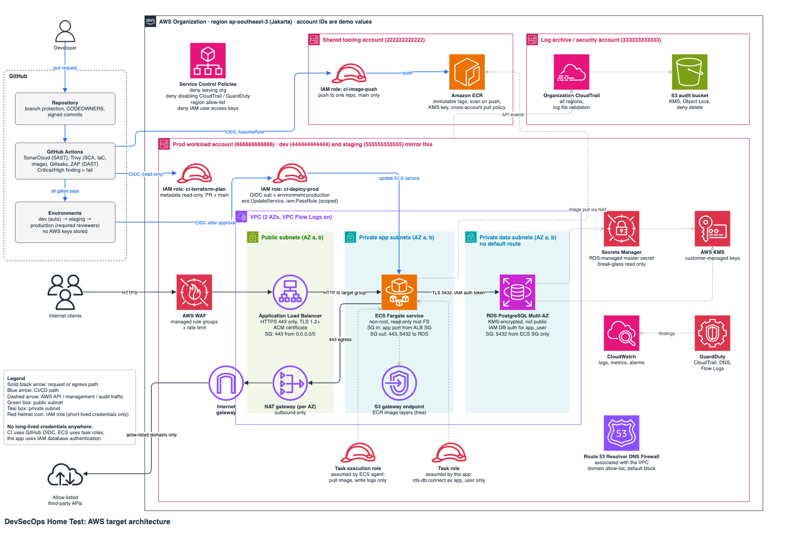

# Task 1: AWS Architecture and Security Design

Sources: [`architecture.drawio`](architecture.drawio) (editable, AWS icons) and [`architecture.mmd`](architecture.mmd) (Mermaid).

## Design summary

| Decision | Choice | Why |
|---|---|---|
| Compute | Amazon ECS on AWS Fargate | No hosts to patch or harden; clear split between task execution role and task role |
| Account model | AWS Organization with a shared tooling account, one workload account per environment (dev, staging, prod), and a log-archive account | An account is the strongest IAM isolation boundary; compromise of dev cannot reach prod |
| Network egress | NAT gateway (one per AZ in prod, a single one in dev and staging), plus the free S3 gateway endpoint; egress filtered and logged | The app can reach AWS APIs and approved third-party services, while outbound traffic stays restricted and visible |
| Database | Amazon RDS PostgreSQL in private data subnets, Multi-AZ in prod; the app connects with **IAM database authentication** | Never publicly reachable; the app has no database password at all |
| Secrets | No application database secret; the RDS-managed master password in AWS Secrets Manager is for admin and break-glass use only | Nothing for the app to leak or rotate; the master password never appears in Terraform variables, code, images or state |
| Encryption | Customer-managed AWS KMS keys (the one exception, ALB access logs, is documented) | Key policies decide who can decrypt, and every use is logged in CloudTrail |
| Ingress | AWS WAF + Application Load Balancer, HTTPS only | Layer-7 filtering and TLS termination at the only public entry point |
| CI/CD identity | GitHub Actions OIDC → short-lived IAM role sessions | No long-lived AWS keys stored in CI/CD variables |
| Audit | Organization CloudTrail to a separate log-archive account, plus GuardDuty and VPC Flow Logs | Logs survive even if a workload account is fully compromised |
| Region | `ap-southeast-3` (Asia Pacific, Jakarta) | Workload and data stay in Indonesia |
| Availability | 2 of the region's 3 Availability Zones | Realistic production resilience without unnecessary cost; a third AZ only needs extra subnets |

The diagram shows the prod account. Dev and staging use the same Terraform modules with smaller sizing (single-AZ RDS, a single NAT gateway, fewer tasks).

### Accounts used in this document

**The account IDs are fictitious, for demonstration only.** This deliverable is a design document, not live infrastructure.

| Account | ID (demo) | Purpose |
|---|---|---|
| Management | `111111111111` | AWS Organizations, SCPs, IAM Identity Center |
| Shared tooling | `222222222222` | Amazon ECR; `ci-image-push` role |
| Log archive / security | `333333333333` | Organization CloudTrail bucket; GuardDuty delegated administrator |
| Dev workload | `444444444444` | `dev` environment; `ci-deploy-dev` |
| Staging workload | `555555555555` | `staging` environment; `ci-deploy-staging` |
| Prod workload | `666666666666` | `production` environment; `ci-deploy-prod` |

---

## 1. Request flow from the internet to the application

1. **DNS:** the client resolves the API hostname (for example `api.example.com`) to the Application Load Balancer.
2. **AWS WAF:** the regional web ACL attached to the ALB evaluates every request before the ALB forwards it:
   - AWS managed rule groups: Core Rule Set, Known Bad Inputs, SQL injection.
   - A rate-based rule that limits requests per source IP.
   - Blocked requests return `403` and never reach the application.
3. **Application Load Balancer (public subnets):**
   - Listens on HTTPS 443 with an ACM certificate and a TLS 1.2+ security policy.
   - Port 80, if enabled, only redirects to HTTPS.
   - Its security group allows `443` from `0.0.0.0/0`, the only inbound internet rule in the design.
4. **Target group → ECS Fargate tasks (private app subnets):**
   - The ALB forwards to the tasks' private IPs on the application port.
   - The task security group allows inbound traffic **only from the ALB security group**.
5. **Application → RDS (private data subnets):**
   - The app connects to PostgreSQL on `5432` over TLS (`rds.force_ssl = 1`) as the dedicated `app_user`.
   - It authenticates with a short-lived **IAM authentication token** instead of a password (see section 3).
   - The RDS security group allows `5432` **only from the task security group**.
6. **The response** returns along the same path. WAF logs and application logs go to CloudWatch Logs; ALB access logs go to S3.

**Outbound traffic from the tasks:**
- ECR image pulls and calls to CloudWatch Logs go to AWS's public endpoints through the **NAT gateway in the same AZ**. They are always TLS-encrypted and authorized by IAM.
- Image layers, which ECR stores in S3, go through the free **S3 gateway endpoint** instead, which keeps them off the NAT and avoids its data-processing charge.
- Approved third-party APIs, if the app ever needs them, also go through the NAT.

Three controls restrict this egress:
- **Security group egress:** the task security group allows only `443` outbound, plus `5432` to the RDS security group.
- **Route 53 Resolver DNS Firewall:** a domain allow-list that blocks by default. It allows only the AWS service domains the tasks need and any approved third-party domains.
- **VPC Flow Logs** go to CloudWatch Logs, and GuardDuty analyzes them for exfiltration or command-and-control patterns.

## 2. Public and private resources

| Public | Private (not reachable from the internet) |
|---|---|
| ALB listener on 443, in public subnets: **the only resource that accepts inbound internet traffic** | ECS Fargate tasks: private app subnets, `assign_public_ip = false` |
| AWS WAF web ACL (attached to the ALB) | RDS: private data subnets, `publicly_accessible = false` |
| NAT gateways in public subnets: **outbound only**; they have Elastic IPs but accept no inbound connections | S3 gateway endpoint (a route-table entry, nothing exposed) |
| Public DNS record and ACM certificate | Secrets Manager, KMS, ECR: reachable only through IAM-authorized API calls, with no public resource policies |
| | S3 audit and log buckets: Block Public Access on, bucket policies deny non-TLS access and access from outside the organization |

The public subnets contain **only** the ALB and the NAT gateways. Private app subnets route `0.0.0.0/0` to the NAT gateway in their own AZ. Private data subnets have **no default route at all**, so the database cannot reach the internet even if misconfigured. Nothing on the internet can start a connection to a private resource.

## 3. How the application gets credentials without hardcoding them

The design follows one rule: **avoid a secret entirely where possible, otherwise let AWS manage it.**

1. **The application has no database password.**
   - RDS is created with `iam_database_authentication_enabled = true`.
   - A dedicated database user, `app_user`, is created once by a migration with `GRANT rds_iam TO app_user` and only the table privileges the app needs. It is **never the master user**.
   - The **task role** may call `rds-db:connect` on exactly that user:
     `arn:aws:rds-db:ap-southeast-3:666666666666:dbuser:db-EXAMPLERESOURCEID/app_user`
   - When opening a connection, the app uses the AWS SDK to sign a token with its task-role credentials. The token is valid for 15 minutes and only works over TLS. Signing happens locally, without a network call.
   - **Nothing exists to hardcode, leak, inject or rotate.** A stolen token expires within minutes.
2. **The master password is managed by AWS and used by admins only.**
   - RDS is created with `manage_master_user_password = true`. RDS generates the master password, stores it in Secrets Manager encrypted with a customer-managed KMS key, and rotates it automatically.
   - **Terraform never sees the value**, so it cannot leak into `terraform.tfstate`. This is the fix for Task 3, Scenario C.
   - Only the admin break-glass permission set may call `secretsmanager:GetSecretValue` on it, and every read raises an alarm.
   - Because the application never uses this secret, rotating it cannot break the app.
3. **Order of preference for any future credential:**
   1. No secret at all: OIDC for CI, IAM roles for AWS services, IAM database authentication.
   2. AWS-managed rotation, as with the RDS master password.
   3. A Secrets Manager rotation Lambda for third parties whose API supports key rotation.
   4. Scheduled manual rotation as a last resort.
4. **Third-party secrets.** The sample app has none. If one is added:
   - It is stored in Secrets Manager and tagged with `owner`, `vendor` and `rotation-period`.
   - The app reads it at runtime through its task role, with a cache that refreshes on authentication failure, so a rotation is picked up without a restart.
   - AWS Config rules (`secretsmanager-rotation-enabled-check`, `secretsmanager-secret-periodic-rotation`) flag overdue rotations.
   - It is rotated immediately when a compromise is suspected.
5. **Non-sensitive configuration** (log level, feature flags) comes from plain environment variables in the task definition, or from SSM Parameter Store (reached through the NAT gateway).

## 4. IAM roles for the CI/CD pipeline and the runtime application

All roles are assumed with short-lived credentials. **There are no IAM users and no access keys anywhere**, and an SCP enforces this.

### CI/CD roles (assumed by GitHub Actions via OIDC)

| Role | Account | Who can assume it (OIDC `sub` condition) | Permissions |
|---|---|---|---|
| `ci-image-push` | Shared tooling | `repo:<org>/<repo>:ref:refs/heads/main` | `ecr:GetAuthorizationToken`; push actions (`ecr:PutImage`, `ecr:InitiateLayerUpload`, `ecr:UploadLayerPart`, `ecr:CompleteLayerUpload`, `ecr:BatchCheckLayerAvailability`) on **one repository ARN** only |
| `ci-terraform-plan` | Each workload account | `repo:<org>/<repo>:pull_request` and `repo:<org>/<repo>:ref:refs/heads/main` only, not arbitrary branches | **Metadata-only read:** `Describe*` / `List*` / `Get*` on the configuration of the services Terraform manages. **Explicit deny on data-plane reads:** `s3:GetObject`, `secretsmanager:GetSecretValue`, `ssm:GetParameter*`, `kms:Decrypt`, `dynamodb:GetItem` / `Query` / `Scan`, `logs:GetLogEvents` / `FilterLogEvents`, `ecr:BatchGetImage`, `rds-data:*`. **No write permissions** |
| `ci-deploy-dev` | Dev workload | `repo:<org>/<repo>:environment:dev` only | Same permission set as `ci-deploy-prod`, scoped to the dev service and task-role ARNs |
| `ci-deploy-staging` | Staging workload | `repo:<org>/<repo>:environment:staging` only | Same permission set, scoped to the staging service and task-role ARNs |
| `ci-deploy-prod` | Prod workload | `repo:<org>/<repo>:environment:production` only | `ecs:RegisterTaskDefinition`; `ecs:UpdateService` and `ecs:DescribeServices` on the one service ARN; `iam:PassRole` on exactly the two task roles, with `iam:PassedToService = ecs-tasks.amazonaws.com` |
| `ci-terraform-apply` (optional) | Each workload account | The matching environment only, with a separate approval | Infrastructure changes, constrained by a **permissions boundary** that blocks creating admin roles or touching the audit and security services |

Trust is pinned to the **repository and the GitHub Environment**. A fork, a feature branch, or a different repository cannot assume any deploy role, even with a valid GitHub token. Each deploy role exists only in its own environment's account, so a dev job can never get staging or prod credentials. Promotion runs in this order:

1. `dev`: deploys automatically from `main`.
2. `staging`: deploys after `dev` succeeds.
3. `production`: deploys after reviewer approval, and can only be used from `main`.

Sessions last at most one hour. Pull requests from forks never receive an OIDC token.

### Runtime roles (assumed by ECS)

| Role | Assumed by | Permissions |
|---|---|---|
| **Task execution role** | The ECS agent, before the container starts | Pull the image from the tooling account's ECR (`ecr:BatchGetImage`, `ecr:GetDownloadUrlForLayer`, `ecr:GetAuthorizationToken`); write to the service's own log group. **No secret access.** |
| **Task role** | The application code | `rds-db:connect` on the single `app_user` database-user ARN. Nothing else; future permissions are added only when the app needs them |

The pipeline can **deploy** the application but cannot **act as** it. The application cannot modify infrastructure, and it cannot read the master database secret.

## 5. Preventing unauthorized access to production resources

Several independent layers, so that no single failure exposes production:

1. **Account isolation:** production runs in its own AWS account. Dev and staging credentials, roles and resources cannot reach it unless a role trust policy explicitly allows it.
2. **Organization guardrails (SCPs)**, which even an administrator in the prod account cannot override:
   - deny leaving the organization;
   - deny stopping or deleting CloudTrail and GuardDuty;
   - deny creating IAM users or access keys;
   - deny regions outside the allow-list (`ap-southeast-3`, plus `us-east-1` for global services);
   - deny disabling S3 Block Public Access or RDS/EBS encryption.
3. **Human access:**
   - IAM Identity Center (SSO) with MFA; read-only permission sets by default.
   - Write access to prod only through a time-bound elevated permission set.
   - A monitored break-glass role, which is the only identity allowed to read the RDS master secret.
   - No SSH or ECS Exec into prod tasks.
4. **Pipeline access:**
   - Each deploy role (`ci-deploy-dev`, `ci-deploy-staging`, `ci-deploy-prod`) trusts only its own GitHub Environment.
   - Production deployment needs reviewer approval.
   - `main` is protected: required reviews, required passing security checks, no force-push.
   - No stored cloud credentials.
5. **Network:**
   - Only the ALB accepts inbound internet traffic.
   - Security groups are chained (ALB → tasks → RDS).
   - RDS is not public, and the data subnets have no default route.
   - Egress from tasks is limited to port 443 and filtered by the DNS Firewall allow-list.
   - VPC Flow Logs are on.
6. **Data:**
   - KMS key policies allow decryption only by the specific roles that need it.
   - Database access for the app is limited to `app_user` through IAM.
   - The cross-account ECR repository policy allows pulls only from the workload accounts' execution roles.
7. **Detection:**
   - The organization CloudTrail writes to an S3 bucket in the log-archive account with Object Lock (compliance mode) and log file validation.
   - GuardDuty runs in every account and analyzes VPC Flow Logs, DNS logs and CloudTrail.
   - CloudWatch alarms fire on root sign-in, console sign-in without MFA, IAM policy changes, security group changes to `0.0.0.0/0`, reads of the RDS master secret, and `AssumeRole` calls on `ci-deploy-prod` outside a pipeline run.

## 6. Security risks and mitigations

| # | Risk | Mitigation in this design |
|---|---|---|
| 1 | **Overly broad IAM:** a compromised CI job or app role gains full account control (`Action: *`) | Separate least-privilege roles for push, plan, deploy (per environment), execution and runtime; resource-level ARNs; `iam:PassRole` limited to two roles; permissions boundaries; Access Analyzer to find unused permissions |
| 2 | **Long-lived production credentials in CI/CD variables** get leaked or reused | GitHub OIDC with short-lived sessions; trust pinned to repository and environment; SCP denies access-key creation |
| 3 | **Secrets committed to Git or baked into images** | Gitleaks as a blocking pipeline gate and a pre-commit hook; the app has no database secret at all (IAM authentication); any other secret lives only in Secrets Manager; Trivy secret scanning of image layers |
| 4 | **Vulnerable container images or dependencies** reach production | Trivy SCA and image scans reject Critical findings, and High findings that have a fix or are known to be exploited (CISA KEV); ECR enhanced scanning (Amazon Inspector) scans on push and keeps re-scanning images already in ECR as new CVEs appear; a nightly pipeline run re-scans `main`; immutable tags; deployments reference the image **digest** that was scanned |
| 5 | **Insecure Terraform**, such as a public database or unencrypted storage | Trivy IaC scan of `.tf` files and of the `terraform plan` JSON blocks Critical/High misconfigurations before apply; SCPs add a second line of defence |
| 6 | **Database exposed to the internet** | Private data subnets with no default route, `publicly_accessible = false`, security group allows only the app security group |
| 7 | **Application-layer attacks** (injection, bots, credential stuffing) | WAF managed rules and rate limiting; SonarCloud SAST and ZAP DAST in the pipeline; TLS 1.2+ only |
| 8 | **Data exfiltration from a compromised task** (the NAT gateway allows outbound traffic) | Security group egress limited to 443; DNS Firewall domain allow-list that blocks by default; VPC Flow Logs analyzed by GuardDuty; the task role can only connect to the database as `app_user`. AWS Network Firewall (filtering on the TLS server name) is the documented upgrade path |
| 9 | **Audit evidence deleted after a compromise** | CloudTrail stored in a separate log-archive account with Object Lock; SCP denies stopping CloudTrail; log file validation detects tampering |
| 10 | **Unapproved or unsafe release** | Pipeline rejects Critical and High findings under the vulnerability policy; new Medium findings need a second engineer's review; protected `production` environment with required reviewers; `main` branch protection |
| 11 | **The application uses the admin database credential**, so an app compromise means full database control | The app connects as a dedicated, least-privilege `app_user` via IAM authentication; the master secret can only be read by the break-glass role, and every read raises an alarm |

---

## Example critical control: OIDC-only, environment-pinned deploy role

> **PLACEHOLDER: to be filled in during the Terraform build phase (Task 3).**
> The example will be taken from the real `terraform/` configuration once it exists and passes
> `terraform validate` and the Trivy IaC scan, rather than written here as a standalone mock.

**Chosen control:** the `ci-deploy-prod` IAM role (`arn:aws:iam::666666666666:role/ci-deploy-prod`). `ci-deploy-dev` and `ci-deploy-staging` follow the same pattern. It addresses two concerns from the brief: production credentials stored in CI/CD variables, and IAM permissions broader than necessary.

The final example must show:

- **Trust policy:** `sts:AssumeRoleWithWebIdentity` from the GitHub OIDC provider only, with `aud = sts.amazonaws.com` and `sub = repo:<org>/<repo>:environment:production`.
- **Session length:** `max_session_duration` of one hour.
- **Permissions:**
  - `ecs:RegisterTaskDefinition` (does not support resource-level permissions);
  - `ecs:UpdateService` / `ecs:DescribeServices` on the single service ARN;
  - `iam:PassRole` on only the task execution role and the task role, with `iam:PassedToService = ecs-tasks.amazonaws.com`.
- **The matching GitHub Actions deploy job:** `environment: production`, `permissions: id-token: write`, and `aws-actions/configure-aws-credentials` pinned to a commit SHA, with no stored AWS secrets.

## Assumptions and limitations

- **This is a design document, not live infrastructure.** Account IDs, domain names and ARNs are fictitious demo values.
- **Plan-only:** Terraform is validated, planned and scanned but **never applied**, and the deploy stage is a protected simulation.
  - In a real setup, `terraform plan` runs in CI through `ci-terraform-plan` against each account; a plan creates nothing and costs nothing.
  - With fictitious account IDs, the submitted pipeline runs `terraform validate` and a Trivy static scan of the `.tf` files. The plan stage is defined, but it only runs once real account credentials are configured.
- **Terraform state** is out of scope because nothing is applied. A real deployment would use an S3 backend in the tooling account with KMS encryption, versioning and native state locking, and read access restricted to the plan and apply roles, because state can contain sensitive values.
- **Bootstrap:** the GitHub OIDC provider, the CI roles and the SCPs must exist before the pipeline can use them. An administrator creates them once, outside the pipeline.
- **ALB access logs** support only S3-managed encryption (SSE-S3), not customer-managed KMS keys. This is a documented exception. The log bucket still blocks public access, requires TLS, has a lifecycle policy, and allows writes only from the Elastic Load Balancing service. Request-level detail is also captured in WAF logs, which go to CloudWatch Logs under a customer-managed key.
- **DNS Firewall can be bypassed** by connecting directly to an IP address. AWS Network Firewall with TLS server-name filtering closes this gap at a higher cost.
- **IAM database authentication** is intended for moderate rates of new connections. The app must use a connection pool, which is standard practice.
- **Single region**, `ap-southeast-3` (Jakarta), using two of its three AZs; there is no multi-region disaster recovery. Jakarta is an **opt-in region**, so it must be enabled in each account, and the SCP region allow-list must include it.
- **ALB → task traffic** is plain HTTP inside the VPC. End-to-end TLS (a certificate in the container) can be added if compliance requires encryption in transit inside the VPC.
