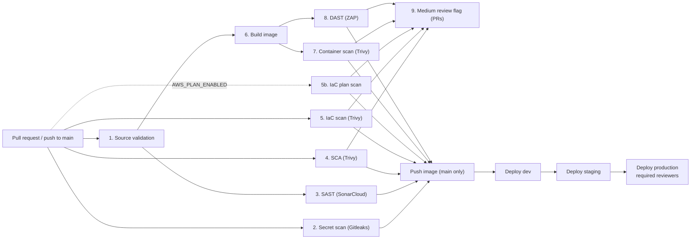

# CI/CD Security Pipeline and Gates

Workflows: [`security-pipeline.yml`](../.github/workflows/security-pipeline.yml) (all gates) and
[`deploy.yml`](../.github/workflows/deploy.yml) (reusable per-environment deploy).
Thresholds: [`vulnerability-policy.md`](vulnerability-policy.md).

> **Scope of this deliverable.** The pipeline is complete and syntactically checked, but it has not
> been run against real services. SonarCloud, GitHub code scanning and AWS are not connected, and the
> AWS account IDs are fictitious. Steps that need AWS run in **simulation mode** unless real access is
> configured (see [GitHub configuration](#github-configuration)).

## Flow

All scans run automatically on every pull request to `main` and every push to `main`. Release jobs
(push and deploy) run only on a push to `main`, and only when **every** gate passed.

A **nightly scheduled run** (02:00 WIB) re-scans `main` with a fresh vulnerability database. A CVE
published after the last commit therefore still fails a run and shows up in code scanning, even if
nobody changes the code. Scheduled runs never push or deploy. GitHub emails a failed scheduled run to
the person who last changed the schedule. ECR enhanced scanning (Amazon Inspector) complements this
by continuously re-scanning images that are already pushed.

## Stages and gates

| # | Job | Tool | What is checked | How the result is evaluated |
|---|---|---|---|---|
| 1 | `source-validation` | Go toolchain, Terraform | `go mod verify` (dependency hashes match `go.sum`), `gofmt`, `go vet`, the test suite with the race detector, `terraform fmt -check`, `terraform validate` against the committed lock file | Any error fails |
| 2 | `secret-scan` | Gitleaks | The **entire git history**, not only the latest change; output is redacted | Any finding fails |
| 3 | `sast` | SonarCloud | Source code: bugs, vulnerabilities, security hotspots | The SonarCloud quality gate (new Blocker/Critical issues, security rating below A on new code). The job waits for it and fails when it fails. A missing token also fails: the gate never skips silently |
| 4 | `sca` | Trivy (`fs`, vuln scanner) | Go dependencies in `go.sum` | `trivy-gate.sh`: Critical or High fails; Medium is counted for the flag |
| 5 | `iac-scan` | Trivy (`config`) | Terraform and the Dockerfile, as static files. The job has no cloud credentials | Critical or High misconfiguration fails. Catches, for example, a database security group open to `0.0.0.0/0` |
| 5b | `iac-plan-scan` | Terraform + Trivy | The `terraform plan` JSON, with variables and modules resolved. Runs only when `AWS_PLAN_ENABLED` is true; it is the **only** job that can get an OIDC token for planning | Same rules as `iac-scan`, plus `scripts/ci/iam-wildcard-gate.sh`, which blocks any Allow with a wildcard action on `Resource: "*"` (Trivy's own check is deprecated). When the job is skipped, the release is not blocked; when it fails, the release is blocked |
| 6 | `build-image` | Docker | Builds once. The image is passed between jobs as an artifact, so the scanned image is exactly the one released | Build errors fail |
| 7 | `container-scan` | Trivy (`image`) | OS packages and the Go binary in the image, plus secrets in image layers; generates a CycloneDX SBOM | Same rules as SCA; any secret fails |
| 8 | `dast` | OWASP ZAP (API scan) | The running container, using its OpenAPI spec | `zap-gate.sh`: a High alert fails; Medium is counted for the flag |
| 9 | `security-review-flag` | `gh` CLI | Sums untriaged Medium findings from jobs 4, 5, 5b, 7 and 8 | Never fails. If the count is above zero, it labels the PR `security-review-required`, requests the security team's review, and comments a summary |
| 10 | `push-image`, `deploy-*` | AWS CLI via OIDC | Pushes to ECR, then promotes by **image digest** dev → staging → production | Each deploy runs in a GitHub Environment; production needs reviewer approval |

**Using one tool for several controls.** Trivy is used for SCA, IaC and container scanning (Checkov was
dropped to reduce the supply-chain attack surface). Each use is a separate job with its own scanner
mode, report and SARIF category, so the results stay separable.

### How a blocked release looks

A finding that violates the policy fails its job:
- the job summary shows a table of the blocking findings, and says for each whether an exception is
  allowed;
- the findings appear in the repository's Security tab (SARIF);
- the raw reports are attached to the run.

Because `push-image` depends on every gate, nothing is pushed or deployed. Examples:

| Change in a PR | Fails at | Why |
|---|---|---|
| An AWS access key added to a config file | `secret-scan` | Any secret blocks, even if it is later removed from the file: history is scanned |
| A dependency with a known Critical CVE | `sca`, then `container-scan` | Critical always blocks |
| An `aws_security_group` allowing `0.0.0.0/0` on port 5432 | `iac-scan` | Critical misconfiguration (Task 3, Scenario B) |
| A base image with an unfixed Critical CVE | `container-scan` | Blocks until fixed or excepted (Task 5, Scenario A) |
| An endpoint reflecting input without encoding | `dast` (and likely `sast`) | High-risk alert |

## Credentials and least privilege

- **No long-lived cloud credentials.** AWS access uses GitHub OIDC with roles that trust only this
  repository, and only specific branches or environments (`architecture/explanation.md`, section 4).
- **Least-privilege token.** The workflow default is `contents: read`. Jobs add only what they need:
  - `security-events: write` to upload SARIF;
  - `id-token: write` only for jobs that assume an AWS role (`iac-plan-scan`, `push-image`, the
    deploy jobs). Jobs that don't need AWS can't request a token at all;
  - `pull-requests: write` only for the review flag.
- `persist-credentials: false` on every checkout, so the token isn't left in `.git/config` for later steps.
- **Untrusted code gets no credentials.** Pull requests from forks get no OIDC token and no secrets, and
  the review-flag job skips forks.
- **The DAST job holds no credentials at all.** The app runs in in-memory mode, with no database and
  no AWS access.

## Keeping secrets out of logs and the repository

- Gitleaks runs with `--redact`, so secret values never appear in logs or reports.
- `SONAR_TOKEN` is the only pipeline secret. GitHub masks it in logs, and it is passed only to the
  SonarCloud step.
- The application has no secrets to inject: it uses IAM database authentication. The image contains no
  secrets, and Trivy's secret scanner checks every layer.
- `.gitignore` excludes Terraform state, `*.tfvars` and local scan output.

## Supply-chain hardening of the pipeline itself

- **Actions pinned by commit SHA**, with the version tag in a comment. Tags can be moved; SHAs can't.
  This matters: in March 2026 the `aquasecurity/trivy-action` tags were force-pushed to malicious commits.
- **Scanners installed as binaries.** Trivy and Gitleaks are downloaded from their releases and
  **checksum-verified before they run** (`scripts/ci/install-tool.sh`). No wrapper actions are used.
- **Images pinned by digest:** the ZAP image here, and the base images in the Dockerfile.
- **Dependabot** opens update PRs for actions, Go modules, base images and Terraform providers. Each PR
  goes through this same pipeline.
- **CODEOWNERS** requires the security team to approve changes to the workflows, gate scripts, exception
  files and scanner configs, so a gate can't be weakened quietly.

## False positives and accepted risks

| Tool | Where it is recorded | Mechanism |
|---|---|---|
| Trivy | `.trivyignore.yaml` | Entry with `statement` (owner, reason, compensating control, approver) and `expired_at` |
| ZAP | `.zap/rules.tsv` | Rule set to `IGNORE`, with owner, reason and review date |
| Gitleaks | `.gitleaks.toml` | Allow-list entry with a reason (for example, the fictitious demo account IDs) |
| SonarCloud | SonarCloud UI | Issue marked *False positive* or *Accepted*, with a comment; restricted to security reviewers |

Rules:
- Every entry is reviewed by the security team (CODEOWNERS).
- Trivy exceptions expire automatically, so accepted risk cannot become permanent by accident.
- Findings with a fix available, findings on CISA KEV, and IaC misconfigurations cannot be excepted.

The full process is in [`vulnerability-policy.md`](vulnerability-policy.md).

## Evidence produced by each run

- **Job summaries:** a policy table per scanner, with the blocking findings.
- **SARIF in GitHub code scanning** (Security tab): Gitleaks, Trivy SCA, Trivy IaC, Trivy image.
- **Run artifacts, kept 30 days:** raw JSON/SARIF reports, the ZAP HTML report, and the SBOM.
- **SonarCloud:** quality gate result and pull-request decoration.

## GitHub configuration

These are repository settings, not code. They are listed here so the setup is reproducible.

- **Branch ruleset on `main`:**
  - require a pull request with 1 approval, including code owners;
  - require these status checks: `source-validation`, `secret-scan`, `sast`, `sca`, `iac-scan`,
    `container-scan`, `dast`. `iac-plan-scan` is not listed because it is skipped while AWS planning
    is off; add it once planning is enabled;
  - block force pushes;
  - allow no bypass, including for admins.
- **Environments:** `dev`, `staging`, `production`, each limited to the `main` branch. `production` also
  has required reviewers, and the person who triggered the run cannot approve it.
- **Environment variables:** `AWS_ACCOUNT_ID`, `ECS_CLUSTER`, `ECS_SERVICE`, `ECS_TASK_FAMILY`.
- **Repository variables:**
  - `AWS_DEPLOY_ENABLED` and `AWS_PLAN_ENABLED`: leave unset for simulation mode;
  - `AWS_TOOLING_ACCOUNT_ID`, `AWS_PROD_ACCOUNT_ID`, `AWS_PLAN_ROLE_ARN`, `SECURITY_REVIEWERS_TEAM`.
- **Secret:** `SONAR_TOKEN`, stored **twice**: as an Actions secret, and as a **Dependabot secret**.
  Runs triggered by Dependabot can only read Dependabot secrets. Without the second copy, the SAST
  gate fails closed on every dependency-update PR, and the pinned versions could never be bumped.

## Known limitations

- **Not executed end to end.** The workflow was validated by parsing, and the gate scripts were tested
  against synthetic reports, but no real run exists, because no external services are connected.
- **Medium findings from SonarCloud** appear as PR decoration rather than in the review-flag count, since
  only the quality-gate result is read back.
- **"New" Medium findings** are approximated as "not yet triaged". The flag doesn't compare against the
  base branch.
- **The CISA KEV feed** only affects the exception guidance in the job summary. If it can't be downloaded,
  every High is still blocked.
- **The Terraform plan scan** needs real AWS access, so with the demo account IDs only the static IaC scan
  runs.
- **The nightly re-scan rebuilds the image from `main`**, using the same pinned base images and modules.
  It's equivalent to the deployed image, but not byte-for-byte the same artifact. ECR enhanced scanning
  covers the pushed artifact itself.
- **Each scan job downloads Trivy's vulnerability database** without a cache. Heavy use could hit
  registry rate limits; a cache step keyed by date would fix that.
